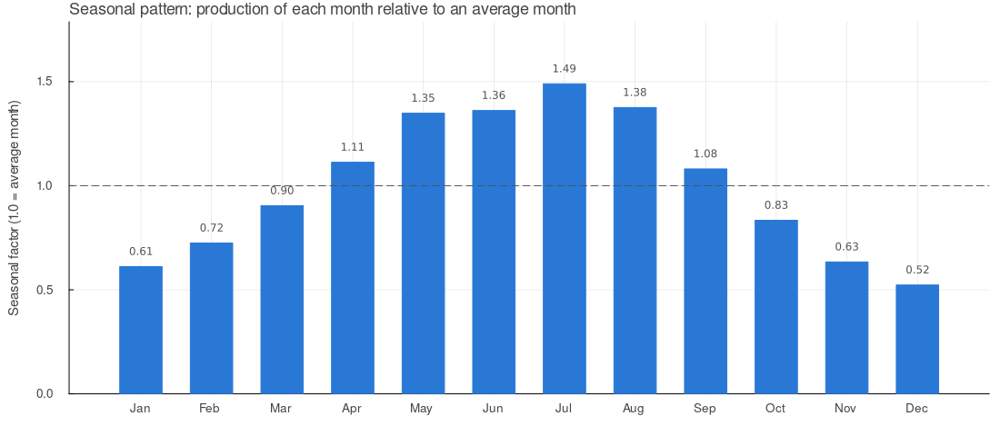
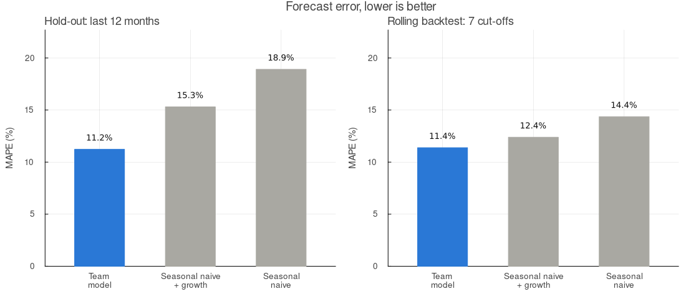
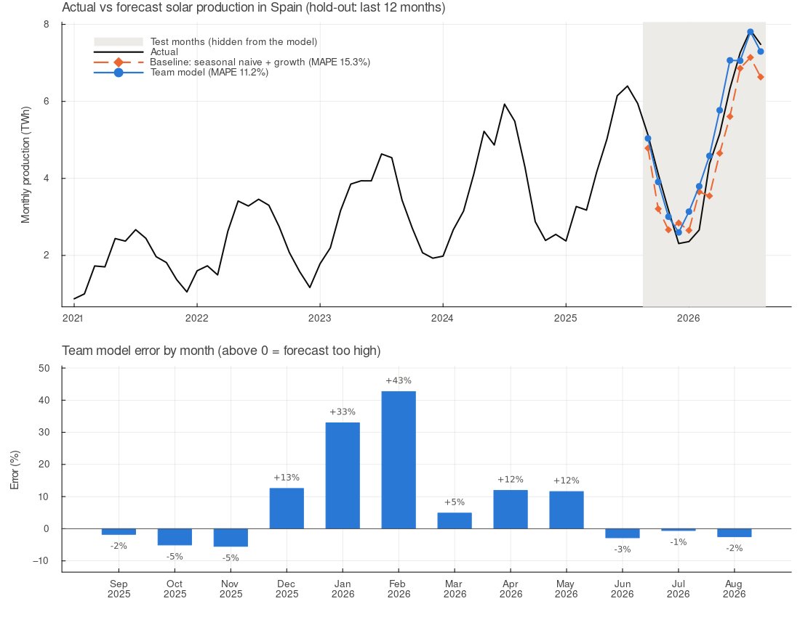
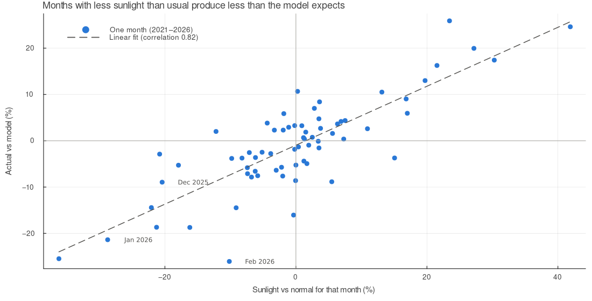

# SolarCastSpain.jl

<!-- DO NOT EDIT BELOW -->
[](../../actions/workflows/tests.yml)
[](../../actions/workflows/docs.yml)
<!-- DO NOT EDIT ABOVE -->


## Overview

<!-- DESCRIBE PROJECT PURPOSE BELOW -->
SolarCastSpain forecasts Spain's future monthly solar energy production using historical data from sources like ENTSO-E/REE and AEMET. The project models long-term solar panel capacity growth alongside seasonal patterns and efficiency losses caused by rising temperatures under various future warming scenarios.
<!-- DESCRIBE PROJECT PURPOSE ABOVE  -->

## Getting started

<!-- DO NOT EDIT BELOW -->
Clone the repository and start Julia in the project folder:

```bash
git clone https://github.com/KLU-BADS/project-4-scientific-programming-2026.git
cd project-4-scientific-programming-2026
julia --project=.
```
<!-- DO NOT EDIT ABOVE -->


<!-- DESCRIBE THE ESSENTIAL USAGE BELOW -->
### Step-by-step guide

All commands are run in a terminal **from the project folder** (the folder created by
`git clone` above). Unless a step shows a separate Windows version, the same command
works in macOS/Linux bash and in Windows PowerShell.

#### 1. Prerequisites

* [Julia](https://julialang.org/install/) **1.12 or newer** (check with `julia --version`)
* [Git](https://git-scm.com/)
* Optional, only for refreshing the sunlight data (step 5): a free API key from
  [AEMET OpenData](https://opendata.aemet.es/)

#### 2. Install the packages (once)

```bash
julia -e 'using Pkg; Pkg.Registry.update()'
julia --project=. -e 'using Pkg; Pkg.resolve(); Pkg.instantiate()'
```

The first line updates Julia's list of available package versions. The second installs
every package the project and the scripts need; they are all declared in the root
`Project.toml`, so nothing has to be installed globally. The first run downloads and precompiles Plots
and can take several minutes.

#### 3. Run the analysis

Run the four scripts in this order. Each one writes its output to the `results/` folder.

**a) Validation**: tests the model on months it has not seen.

```bash
julia --project=. scripts/run_validation.jl
```

Expected (end of the output):

```
4. Rolling backtest: 12-month forecasts from 7 cut-offs (2023-12 to 2025-06), averaged
  forecaster                           MAE       RMSE     MAPE       bias
  team model (full)                  433.9      513.5    11.4%      +57.5
  ...
  seasonal naive + growth            464.2      578.5    12.4%     +278.7
  seasonal naive                     601.6      726.4    14.4%     -535.5
```

**b) Validation chart**

```bash
julia --project=. scripts/plot_validation.jl
```

Expected: `Saved results/validation_actual_vs_forecast.png`

**c) Forecast**: forecasts Sep 2026 – Dec 2028 under 0, +1, +2 and +3 °C of warming.

```bash
julia --project=. scripts/run_forecast.jl
```

Expected:

```
Annual solar production (complete years)
  year   scenario      total (TWh)      vs no warming
  2027   no warming          71.09              0.00%
  2028   no warming          79.51              0.00%
  ...
Saved results/forecast_monthly_scenarios.csv, results/forecast_annual_summary.csv, results/forecast_scenarios.png
```

**d) Result charts**

```bash
julia --project=. scripts/plot_results.jl
```

Expected:

```
Hold-out MAPE:  team model 11.2%, naive + growth 15.3%, naive 18.9%
Backtest MAPE:  team model 11.4%, naive + growth 12.4%, naive 14.4%
Sunlight vs model gap: correlation 0.82
Saved results/accuracy_comparison.png, results/seasonal_pattern.png, results/sunlight_effect.png
```

#### 4. Run the tests

```bash
julia --project=. -e 'using Pkg; Pkg.test()'
```

Expected: `Testing Project4 tests passed`

#### 5. Optional: refresh the data

`data.csv` is already included, so this step is only needed to download the data again.
All three download scripts need an internet connection.

**a) Solar production** (REE open data, no key needed):

```bash
julia --project=. scripts/collect_solar_ree.jl
```

**b) Temperature** (AEMET; the first run takes a few minutes):

```bash
julia --project=. scripts/temperature.jl
```

**c) Sunlight hours** (AEMET OpenData, needs your API key). Set the key for the current
terminal session only. Never write it into a file or commit it.

macOS / Linux:

```bash
export AEMET_API_KEY="your-key"
julia --project=. scripts/collect_sunlight_aemet.jl
```

Windows PowerShell:

```powershell
$env:AEMET_API_KEY = "your-key"
julia --project=. scripts/collect_sunlight_aemet.jl
```

**d) Check, then update `data.csv`.** First see which values would change:

```bash
julia --project=. scripts/update_data_csv.jl --dry-run
```

If the downloaded data matches the current file, this prints `0 value(s) would change.`
Only if you want to apply the changes, run it again without `--dry-run`, then rerun
step 3 so the results match the new data.

Data sources: REE open data ([apidatos.ree.es](https://apidatos.ree.es)) and AEMET
OpenData ([opendata.aemet.es](https://opendata.aemet.es)).

#### 6. Troubleshooting

| Message | Meaning and fix |
|---|---|
| `Unsatisfiable requirements detected for package ...` | Julia's list of package versions is out of date. Run `julia -e 'using Pkg; Pkg.Registry.update()'`, then step 2 again. |
| `... is a direct dependency, but does not appear in the manifest` or `Package Plots ... is required but does not seem to be installed` | The installed packages don't match the project anymore (for example after a `git pull`). Run the second command of step 2 again. |
| `N dependencies precompiled but different versions are currently loaded` | Harmless. It only appears in the same Julia session that just installed packages. |
| `SystemError: opening file ".../scripts/run_validation.jl": No such file or directory` or `fatal: not a git repository` | The terminal is not in the project folder. `cd` into the folder created by `git clone` and try again. |
| `Syntax Error: Can't get Fields array` (from `temperature.jl`) | Harmless warning from Poppler while reading the AEMET PDF reports. The script continues. |
| `Connection problem, retrying in ...` (often with `EOFError`, from `collect_sunlight_aemet.jl`) | The AEMET server dropped the connection. The script retries automatically up to 5 times. |
| `Station has missing months (or no data)` | One weather station did not report every month. Harmless: the national value is averaged over the stations that did report. |
| `Set the AEMET_API_KEY environment variable first` | Set your key as shown in step 5c, in the same terminal window. |
| The first script takes several minutes before printing anything | Normal on the first run: Julia is precompiling Plots and the other packages. Later runs are much faster. |

#### Using the functions directly

All functions are part of the `Project4` package, so they can also be used directly,
for example in the Julia REPL started with `julia --project=.`:

```julia
using Project4
data  = load_data()                          # data.csv, one row per month
model = train_model(data)                    # trend and seasonal factors
validate(forecast_model, data).metrics       # (mae, rmse, mape, bias) on the last 12 months
```
<!-- DESCRIBE THE ESSENTIAL USAGE ABOVE -->

## Results

### The model

Monthly solar production is modelled as

```
production = growth trend × seasonal factor × temperature efficiency
```

- **Growth trend:** a straight line fitted to all months, capturing the growth in installed solar capacity (about +700 GWh per month each year).
- **Seasonal factor:** how much each calendar month produces compared with an average month.
- **Temperature efficiency:** panels lose 0.4 % of their output for every °C above 25 °C.



July produces about 1.5 times an average month, December only about half.

### How accurate is the model?

We hid the most recent data, forecast it, and compared the forecast with what actually happened. The error is measured as MAPE, the average monthly miss in percent (lower is better).

- **Hold-out:** the model is trained on Jan 2021 – Aug 2025 and forecasts the last 12 months (Sep 2025 – Aug 2026).
- **Rolling backtest:** the same test repeated from 7 different starting points, then averaged. This is more reliable than a single test.

| Forecast method | Hold-out MAPE | Backtest MAPE |
|---|---|---|
| **Our model** | **11.2 %** | **11.4 %** |
| Seasonal naive + growth (same month last year × last year's growth) | 15.3 % | 12.4 % |
| Seasonal naive (same month last year) | 18.9 % | 14.4 % |



Our model beats both simple methods in both tests.



Summer and autumn are forecast within about 5 %. The largest errors are in December 2025 – February 2026 (up to +43 %), a winter with far less sunlight than usual.

### Forecast for 2027 and 2028

The model is fitted on all 68 months (Jan 2021 – Aug 2026). Future months use the typical temperature of each calendar month, plus 0, 1, 2 or 3 °C of warming.

| Year | No warming | +1 °C | +2 °C | +3 °C |
|---|---|---|---|---|
| 2027 | 71.09 TWh | 71.05 TWh (−0.06 %) | 70.98 TWh (−0.15 %) | 70.91 TWh (−0.25 %) |
| 2028 | 79.51 TWh | 79.46 TWh (−0.06 %) | 79.38 TWh (−0.15 %) | 79.31 TWh (−0.25 %) |

For comparison, our data shows about 51 TWh of solar production in 2025. Full tables: [`forecast_annual_summary.csv`](results/forecast_annual_summary.csv) and, month by month, [`forecast_monthly_scenarios.csv`](results/forecast_monthly_scenarios.csv).

### Limitations

**Sunlight hours are not used by the model.** Months with less sunlight than usual produce less than the model expects, and this explains much of the remaining error (correlation 0.82):



- **Temperature:** the efficiency loss is applied to monthly average *air* temperature above 25 °C. Spain's monthly averages rarely reach this, so the warming effect in the model is very small. Panels run much hotter than the air, so the real effect of warming is probably larger.
- **Straight-line trend:** the model assumes the same growth every year. This is reasonable for 1–2 years ahead, but uncertain further out.
- **Short history:** only 68 months of data are available.

### Conclusion

Spain's solar production is expected to keep growing strongly, from about 51 TWh in 2025 to about 79.5 TWh in 2028, driven mainly by new installed capacity. Within our model, warming reduces production only slightly: about 0.25 % per year even under +3 °C. The model forecasts unseen months with an average error of about 11 %, better than simple baseline methods. The most promising improvements are adding sunlight hours, using panel temperature instead of air temperature, and allowing growth to slow down over time.

## Tests

<!-- DO NOT EDIT BELOW -->
Tests are run automatically on GitHub for every push to `main` and on every pull request.

> [!TIP]
> To run the tests locally, run
> ```bash
> julia --project=. -e 'using Pkg; Pkg.test()'
> ```
 
<!-- DO NOT EDIT ABOVE -->


## Documentation

<!-- DO NOT EDIT BELOW -->
The [online documentation](https://klu-bads.github.io/project-4-scientific-programming-2026/) is automatically built and published to GitHub Pages on every push to `main`.

> [!TIP]
> To build the documentation locally, run
> ```bash
> julia --project=docs docs/make.jl
> ```
> and open `docs/build/index.html` in a browser.
>
> If building the documentation fails, run the tests locally before. 


<!-- DO NOT EDIT ABOVE -->

## Contributing

<!-- DO NOT EDIT BELOW -->
See [CONTRIBUTING.md](CONTRIBUTING.md).
<!-- DO NOT EDIT ABOVE -->

## License

<!-- DO NOT EDIT BELOW -->
MIT. See [LICENSE](LICENSE).
<!-- DO NOT EDIT ABOVE -->
