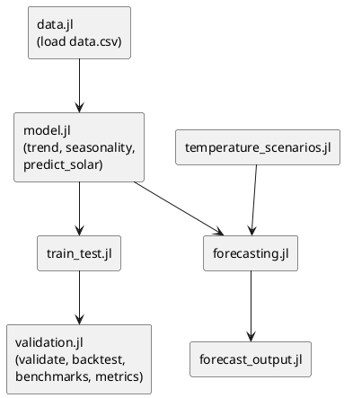

# Project design

This page describes how the project is built: which file does what, how the files work together, what data they need, and what they produce.

The workflow is:

Data → Model → Validation → Forecasting → Output

## Files and responsibilities

| File | Responsibility |
|---|---|
| `data.jl` | Loads `data.csv` into a DataFrame, removes incomplete rows and adds the `time` column (`load_data`). |
| `model.jl` | Defines the forecasting model: estimating the trend and seasonal factors, the temperature efficiency, and `predict_solar`, the single-month forecast function used by every other file. |
| `train_test.jl` | Wraps the model so it can be trained on some months and tested on others (`train_model`, `predict_model`, `forecast_model`, `forecast_model_no_temperature`). |
| `validation.jl` | Model-independent validation tools: hold-out split, rolling backtest, error metrics and benchmark forecasters. |
| `temperature_scenarios.jl` | Builds future monthly temperatures from the historical monthly average plus a warming value. |
| `forecasting.jl` | Applies a prediction function to a list of future months (`generate_forecast`). |
| `forecast_output.jl` | Organises forecasts into a results table (`create_forecast_output`). |
| `Project4.jl` | The package module; includes the files above and exports their functions. |

The `scripts/` folder holds the runnable steps: downloading the data (`collect_solar_ree.jl`, `collect_sunlight_aemet.jl`, `temperature.jl`), updating `data.csv` (`update_data_csv.jl`), running the validation and the forecast (`run_validation.jl`, `run_forecast.jl`) and making the charts (`plot_validation.jl`, `plot_results.jl`). Data files are written to `data/`, all other outputs to `results/`. See the README for how to run them.

## Data

The model uses one row per month with these columns:

* `year`, `month`: the calendar month
* `solar_gwh`: solar electricity production in GWh
* `avg_temperature_c`: monthly mean temperature in °C
* `sunlight_hours`: monthly sunshine hours (not used by the model; used to analyse the forecast errors)

Months with a missing value in any of these columns are removed before the model is fitted.

## Model (`model.jl`)

Each monthly forecast is the product of three components:

```
forecast = trend(time) × seasonal factor(month) × temperature efficiency(temperature)
```

**Time index.** Year and month are combined into one continuous variable: years since January 2021 (January 2021 = 0, February 2021 = 1/12, January 2022 = 1).

**1. Trend.** A straight line fitted by ordinary least squares (`estimate_trend`). It is described by an intercept and a slope. The slope is how much each month's production increases per year, mainly because new capacity is installed.

**2. Seasonal factors.** For every historical month, actual production is divided by (trend × temperature efficiency). These ratios are averaged for each calendar month, giving 12 factors, which are then scaled so they average exactly 1 (`estimate_seasonality`). Factors above 1 mark strong months (summer) and factors below 1 mark weak months (winter). Because they average 1, they shift production between months without changing the yearly level, which is set by the trend.

**3. Temperature efficiency.** A fixed rule (`temperature_efficiency`):

| Monthly mean temperature | Efficiency factor |
|---|---|
| ≤ 25 °C | 1.000 |
| 27.5 °C | 0.990 |
| 30 °C | 0.980 |

The factor is 1.0 up to 25 °C (`REF_TEMP`) and falls by 0.4 % per degree above it (`TEMP_COEF = -0.004`). The coefficient is an assumption based on typical photovoltaic panel behaviour, not estimated from our data. The temperature effect is removed **before** the seasonal factors are computed, so heat losses are not counted twice.

**Prediction.** `predict_solar(time, month, temp_c, trend, seasonality)` returns the forecast in GWh for one month.

The components are multiplied rather than added because the seasonal swing grows with installed capacity: more panels mean higher summer peaks.

## Validation (`train_test.jl`, `validation.jl`)

The model is tested on months it has not seen:

* **Hold-out test** (`validate`): train on January 2021 – August 2025 (56 months), forecast the last 12 months (September 2025 – August 2026) and compare with the actual values.
* **Rolling backtest** (`backtest`): repeat this from 7 different cut-off points and average the results. This is more reliable when the history is short.
* **Benchmarks**: the model is compared (`compare_forecasters`) with two simple methods:
  * `seasonal_naive`: same month last year
  * `seasonal_naive_growth`: same month last year × last year's growth
* **Temperature check**: `forecast_model_no_temperature` runs the same model without the temperature factor, to measure what the temperature component adds.
* **Error measures** (`evaluate`): MAE, RMSE, MAPE and bias.

During validation, the trend and seasonal factors are fitted on the training months only, so the test months never influence the model.

## Forecasting (`temperature_scenarios.jl`, `forecasting.jl`, `forecast_output.jl`)

1. `monthly_temperature_baseline` computes the historical average temperature for each calendar month.
2. `future_temperature_scenario` adds a warming value (0, +1, +2 or +3 °C) to that baseline.
3. `generate_forecast` calls `predict_solar` for every month from September 2026 to December 2028, using the trend and seasonal factors fitted on all 68 months.
4. `create_forecast_output` returns a table with year, month, scenario, temperature and forecast (GWh).

The forecast is not built from the last observed value: it reads the fitted trend line at each future month and applies that month's seasonal factor and the scenario's temperature.

## Component interaction



## Output

* Validation results comparing predicted and actual production, with error metrics for the model and the benchmarks.
* Monthly solar production forecasts up to 2028, one table per warming scenario.
* Plots of historical production, seasonal patterns, validation results and forecasts.

For the numbers, charts and limitations, see the [Results section of the README](https://github.com/KLU-BADS/project-4-scientific-programming-2026#results).
